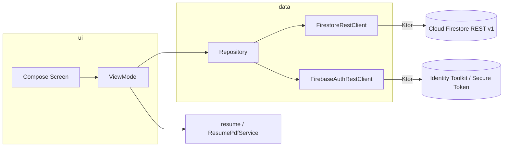

# Derek Portfolio — Android

Flutter Web 으로 운영 중인 개인 포트폴리오 사이트를 **Android 네이티브(Jetpack Compose)** 로 옮긴 앱입니다.
웹과 같은 Firebase 프로젝트(Firestore · Authentication)를 사용하며, **Firebase SDK 없이 REST API 를 Ktor 로 직접 호출**합니다.

- 방문자 화면: 프로필 · 기술 스택 · 경력 · 프로젝트 아카이브 · 연락처
- 관리자 화면: 이메일 로그인 후 콘텐츠 편집, 방문 기록 조회/정리
- 이력서 PDF: 콘텐츠를 A4 이력서로 조판해 미리보기 · 저장 · 공유 · 인쇄
- 방문 기록: 앱 실행 시 IP 기반 위치와 기기 정보를 Firestore 에 기록

---

## 기술 스택

| 영역 | 사용 기술 |
| --- | --- |
| 언어 / 빌드 | Kotlin 2.2.20, AGP 9.3.2, Gradle 9.5.0, KSP 2.3.6, JDK 17 |
| UI | Jetpack Compose (BOM 2025.08.01), Material 3, Navigation Compose 2.9.3 (type-safe route) |
| 비동기 | Kotlin Coroutines 1.10.2, StateFlow / Channel |
| 네트워크 | Ktor Client 3.2.3 (OkHttp 엔진), kotlinx.serialization 1.9.0 |
| DI | Hilt 2.57.2 (KSP) |
| 저장소 | DataStore Preferences 1.1.7 (로그인 세션, 기기 ID) |
| PDF | `android.graphics.pdf.PdfDocument` + `StaticLayout` (조판), `PdfRenderer` (미리보기) |
| SDK | minSdk 26 / targetSdk 36 |

---

## 아키텍처

단일 모듈, 레이어 구조입니다. UI 는 ViewModel 의 `StateFlow` 를 구독하고, 저장소가 REST 클라이언트를 감쌉니다.



### 패키지 구조

```
com.derek.portfolio
├── FirebaseConfig.kt          # API 키 · 프로젝트 ID
├── PortfolioApp.kt            # @HiltAndroidApp, 방문 기록 트리거
├── MainActivity.kt
├── di/AppModule.kt            # HttpClient, Json, DataStore, ApplicationScope
├── data
│   ├── model/                 # ProfileData, ProjectData, SiteContent, 기본(샘플) 데이터
│   ├── remote/                # Firestore · Auth REST 클라이언트, Firestore 값 코덱
│   ├── repository/            # AuthRepository, ContentRepository, VisitLogRepository
│   └── visit/                 # 방문 기록 모델 · VisitLogger
├── resume/                    # PDF 조판 엔진, 캐시 서비스, 렌더링/저장/인쇄
└── ui
    ├── theme/                 # 색상 · 폰트 · MaterialTheme
    ├── components/            # 공용 컴포저블, 스낵바, 외부 링크 열기
    ├── navigation/            # AppNavHost (Portfolio ↔ Admin)
    ├── portfolio/             # 방문자 화면 섹션들, 경력별 프로젝트 모달
    ├── resume/                # 이력서 미리보기 다이얼로그
    └── admin/                 # 로그인, 프로필/프로젝트 편집기, 방문 기록
```

---

## Firebase REST 연동

Firebase Android SDK 를 쓰지 않고 필요한 API 만 직접 호출합니다. 웹 앱과 같은 API 키를 사용합니다.

| 용도 | 엔드포인트 |
| --- | --- |
| 문서 읽기 | `GET  firestore.googleapis.com/v1/{documents}/site/profile` |
| 쿼리 | `POST {documents}:runQuery` (structuredQuery) |
| 덮어쓰기 | `PATCH {documents}/{path}` (updateMask 없음 = set) |
| 삭제 | `DELETE {documents}/{path}` |
| 원자적 일괄 쓰기 | `POST {documents}:commit` |
| 이메일 로그인 | `POST identitytoolkit.googleapis.com/v1/accounts:signInWithPassword` |
| 비밀번호 재설정 | `POST identitytoolkit.googleapis.com/v1/accounts:sendOobCode` |
| ID 토큰 갱신 | `POST securetoken.googleapis.com/v1/token` |

구현 포인트

- **값 코덱** (`FirestoreValues`) — REST 의 타입 래핑(`stringValue`, `integerValue` …)을 `Map<String, Any?>` 로 풀고 감쌉니다. 모델은 SDK 를 쓸 때처럼 맵만 다룹니다.
- **토큰 관리** (`AuthRepository`) — 세션을 DataStore 에 저장하고, 만료 60초 전이면 요청 직전에 갱신합니다. 401 응답은 한 번 강제 갱신 후 재시도합니다.
- **쓰기** — 새 문서 ID 는 클라이언트에서 만들어 `commit` 에 담습니다. 여러 문서를 원자적으로 쓰고, 재시도해도 문서가 중복 생성되지 않습니다. 프로젝트 저장 시 나머지 항목의 `order` 도 같은 commit 에서 맞춥니다.
- **서버 시각** — 방문 기록의 `createdAt` 은 `updateTransforms: REQUEST_TIME` 으로 채웁니다 (보안 규칙이 `request.time` 과 비교).
- **타임아웃** — 콘텐츠 읽기는 8초 제한. 방문자 화면은 실패 시 내장 데이터로 폴백, 관리자 화면은 오류와 재시도를 표시합니다.

### Firestore 데이터 구조

| 경로 | 내용 | 접근 |
| --- | --- | --- |
| `site/profile` | 이름, 직함, 소개, 연락처, 스킬 그룹, 경력 | 읽기 공개 / 쓰기 관리자 |
| `projects/{id}` | 프로젝트 1건, `order` 오름차순 노출 | 읽기 공개 / 쓰기 관리자 |
| `admins/{uid}` | 편집 권한 계정 목록 (문서 존재 여부만 확인) | 본인 문서 get 만 허용 |
| `visits/{기기ID_시간칸}` | 방문 기록 | 생성 누구나 / 읽기·삭제 관리자 |

보안 규칙(`firestore.rules`)은 웹 프로젝트에서 함께 관리합니다. 앱의 검사는 안내용이고 실제 차단은 규칙이 합니다.

---

## 빌드 & 실행

### 요구 사항

- Android Studio (Gradle JDK 17 이상)
- Android SDK Platform 36

### 명령

```bash
./gradlew assembleDebug          # 디버그 APK
./gradlew installDebug           # 연결된 기기/에뮬레이터에 설치
./gradlew testDebugUnitTest      # 단위 테스트
./gradlew assembleRelease        # R8 난독화·리소스 축소 적용 (서명 설정 별도 필요)
```

`local.properties` 에 `sdk.dir` 이 필요합니다(Android Studio 가 자동 생성).

> `gradle.properties` 의 `android.builtInKotlin=false`, `android.newDsl=false` 등은 AGP 9 로 올리면서
> 기존 Kotlin 플러그인 구성을 유지하기 위한 호환 플래그입니다.

---

## 설정

### Firebase 프로젝트

`app/src/main/java/com/derek/portfolio/FirebaseConfig.kt`

```kotlin
const val API_KEY = "..."      // 웹 앱과 같은 브라우저 API 키
const val PROJECT_ID = "..."
```

API 키는 요청을 프로젝트에 묶는 식별자일 뿐 비밀 값이 아닙니다. 다만 Google Cloud 콘솔에서 키의 **API 제한**을
Cloud Firestore API, Identity Toolkit API, Token Service API 로 좁혀 두는 것을 권장합니다.
(웹과 앱이 같은 키를 쓰므로 HTTP 리퍼러/앱 제한은 걸지 않습니다.)

### 관리자 계정

1. Firebase Console → Authentication → 이메일/비밀번호 로그인 활성화, 사용자 추가
2. Firestore 에 `admins/{UID}` 문서 생성 (필드는 없어도 됨)
3. 앱 푸터의 `관리자` 버튼 → 로그인

### 기본 데이터

`app/src/main/java/com/derek/portfolio/data/model/DefaultContent.kt`

- Firestore 를 읽지 못했을 때의 **폴백**이자 관리자 화면 `기본 데이터 가져오기` / `초기화` 의 **시드**입니다.
- 공개 저장소이므로 **가짜 샘플 데이터**만 들어 있습니다. 실제 콘텐츠는 Firestore 에서 관리합니다.
- `초기화` 는 기존 프로젝트 문서를 모두 지우고 샘플로 덮어쓰니 운영 데이터에서는 사용에 주의하세요.

---

## 주요 기능 구현 메모

### 방문자 화면

- `LazyColumn` 한 장에 섹션을 항목으로 배치. 화면 폭에 따라 프로젝트 카드 1/2열.
- 관리자 화면에서 돌아오면(`ON_RESUME` + 진입 플래그) 콘텐츠를 다시 읽고, 실패 시 기존 화면을 유지합니다.
- 경력 항목의 회사명과 프로젝트의 회사명을 괄호·공백 제거 후 정확히 일치시켜 경력별 프로젝트 모달을 엽니다.

### 관리자 화면

- 인증 상태(`Restoring` / `SignedOut` / `SignedIn`) → 권한 확인 → 편집기 순으로 화면 전환.
- 편집 상태는 ViewModel 이 Compose Snapshot State 로 보관하므로 회전·탭 이동에도 입력이 유지됩니다.
- 프로젝트 저장 · 전체 저장 · 삭제 · 순서 변경은 `Mutex` 로 직렬화해 중복 생성과 경쟁 상태를 막습니다.

### 이력서 PDF

- `ResumePdfComposer` 가 블록 단위로 측정 → 페이지 배치 → 그리기를 수행합니다.
  프로젝트 블록은 페이지 경계에서 쪼개지 않고, 섹션 제목은 뒤따르는 내용과 같은 페이지에 둡니다.
- 결과는 `SiteContent` 인스턴스 단위로 캐시해 미리보기·저장·공유·인쇄가 같은 문서를 씁니다.
- 저장은 SAF(`CreateDocument`), 공유는 `FileProvider`, 인쇄는 `PrintManager` 를 사용합니다.
- `PdfDocument` 는 링크 주석을 지원하지 않아 링크는 주소를 텍스트로 함께 표기합니다.

### 방문 기록

- 앱 프로세스당 1건. 로그인 세션이 있으면(관리자) 기록하지 않습니다.
- `ipwho.is` → `get.geojs.io` 순으로 IP/위치를 조회하고 실패해도 기록은 남깁니다.
- 문서 ID `기기ID_(시각/10초)` 가 보안 규칙과 맞물려 10초 쓰기 제한으로 동작합니다.

---

## 테스트

JVM 단위 테스트 (`app/src/test`)

| 테스트 | 검증 내용 |
| --- | --- |
| `FirestoreValuesTest` | REST 값 인코딩/디코딩, 모델 왕복 변환 |
| `CareerMatchingTest` | 경력 ↔ 프로젝트 회사명 매칭 규칙 |
| `VisitModelsTest` | 방문 문서 ID, User-Agent 요약, IP 조회 응답 파싱 |

---

## 알려진 제약 / TODO

- **App Check 미적용** — 웹은 reCAPTCHA Enterprise 를 쓰지만 앱은 아직 연동하지 않았습니다.
  Firestore 에 App Check 적용(enforce)을 켜기 전에 Play Integrity 제공자를 붙여야 합니다.
- PDF 내 링크는 클릭할 수 없습니다(`PdfDocument` 제약).
- 릴리스 서명 설정은 저장소에 포함하지 않습니다.
